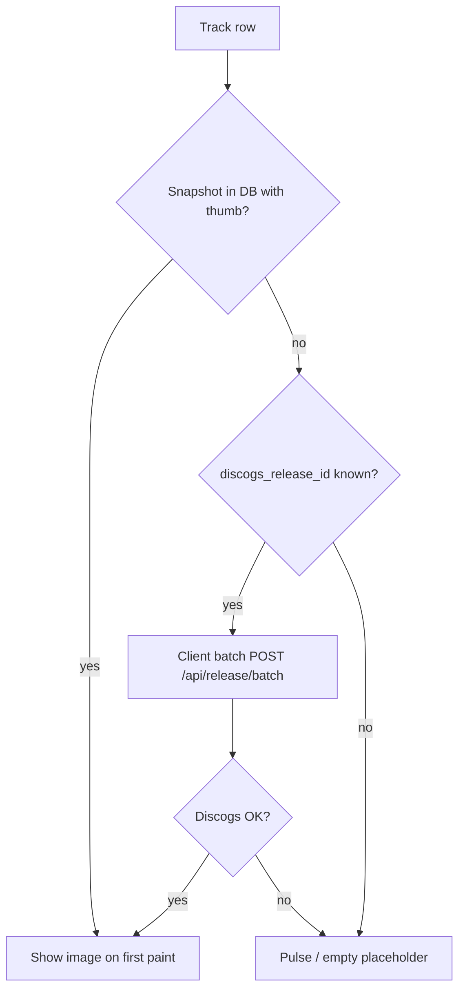

# Public sharing: playlists, crates, and release pages

## What users experience

- Anyone with a link can open **`/playlist/[id]`**, **`/crate/[id]`**, or **`/release/[id]`** without signing in.
- Playback (YouTube embeds) works on those pages via a dedicated shell.
- Playlist track rows may show cover art immediately, after a short wait, or as a pulse placeholder—depending on whether we already stored a snapshot.

## Moving parts

| Route | Data loader | Client hook / UI |
| ----- | ----------- | ---------------- |
| `/playlist/[id]` | [`getPublicPlaylistForPage`](../../../src/lib/public-playlist.server.ts) → [`loadPublicPlaylist`](../../../src/lib/public-playlist-load.server.ts) | [`usePublicPlaylistQuery`](../../../src/hooks/queries/usePublicPlaylistQuery.ts), [`usePublicPlaylistReleases`](../../../src/hooks/usePublicPlaylistReleases.hook.ts) |
| `/crate/[id]` | Public crate server helpers + `usePublicCrateQuery` | [`PublicCrateClient`](../../../src/components/PublicCrate/PublicCrateClient.component.tsx) |
| `/release/[id]` | [`loadPublicReleaseDiscogsDetailForPage`](../../../src/lib/public-release-discogs-detail.server.ts) | [`PublicReleasePage`](../../../src/components/PublicReleasePage/PublicReleasePage.component.tsx) |

Playback: logged-out visitors use [`PublicSharePlaybackShell`](../../../src/components/PublicSharePlaybackShell/PublicSharePlaybackShell.component.tsx); signed-in users share the same provider via [`AuthenticatedProvidersGate`](../../../src/components/AuthenticatedProvidersGate.component.tsx). See [playback.md](playback.md).

## Decisions & rationale

### Fast SSR with `snapshotsOnly` (default)

**Decision:** Cached playlist SSR and default `GET /api/playlists/public/[id]` use `discogsHydration: "snapshotsOnly"`—Postgres + JSON snapshots only, **no live Discogs** on the hot path.

**Why:**

- Public HTML is built with `use cache` (~5 minute revalidate). Sequential Discogs fetches per view would block TTFB and compete for the shared throttle queue.
- We already store enough structure in **`crate_releases`** and **`playlist_release_snapshots`** to render most rows when snapshots are warm.

**Tradeoff:** Rows without snapshot art depend on a **client** batch (`POST /api/release/batch`) after hydrate—users may see pulse placeholders briefly. Each batch runs **sequential** Discogs fetches (shared throttle, max **25** ids per request), so TTFB can reach **tens of seconds** when many unique releases lack art—normal for the proxy, not a hung browser.

**`snapshotsOnly` server cap:** [`loadPublicPlaylist`](../../../src/lib/public-playlist-load.server.ts) may call [`backfillMissingDisplayArtInSnapshotMap`](../../../src/lib/public-playlist-discogs.server.ts) (at most **`PUBLIC_PLAYLIST_MISSING_ART_BACKFILL_MAX_RELEASE_IDS`** Discogs ids per load) and persist warmed rows so repeat views skip batch. Long-tail rows may still use client batch.

**Client defer:** [`usePublicPlaylistReleases`](../../../src/hooks/usePublicPlaylistReleases.hook.ts) skips **`useHydrateDiscogsReleaseDetails`** while **`useIsMiniPlayerVisible`** so cover batch does not contend with YouTube embed progress sync. [`PublicPlaylistClient`](../../../src/components/PublicPlaylist/PublicPlaylist.component.tsx) passes SSR **`apiReleases`** into **`usePlaylistPlayback`**, not client-merged releases.

### Optional `discogsHydration: full` (ops / backfill)

**Decision:** Public GET accepts `?discogsHydration=full` to run [`hydratePublicPlaylistReleases`](../../../src/lib/public-playlist-discogs.server.ts) and optionally persist snapshots—not used by default client refetch.

**Why:** Backfill and admin-style warming without changing the default UX contract for every visitor.

### Client batch only for releases still missing art

**Decision:** [`collectUniquePlaylistDiscogsReleaseIdsNeedingArtHydration`](../../../src/utils/discogsReleaseArt.ts) batches ids that have a Discogs release id but no thumb/cover on the merged release object.

**Why:** Avoids refetching covers we already have in snapshot JSON; dedupes ids across many tracks on the same album.

### `UserTrack.discogs_release_id` is necessary but not sufficient

**Decision:** Track rows carry `discogs_release_id`, but the UI reads **`DiscogsRelease.basic_information`** from the per-instance map—not the id alone.

**Why:** Titles, artists, and image URLs live on the release snapshot/detail object. Legacy rows may still have `null` ids until backfill from a snapshot row on load.

**Future improvement (documented intent):** Backfill **`playlist_release_snapshots`** (and crate snapshots) with `cover_image` so `snapshotsOnly` first paint rarely needs client batch. See [crates-and-playlists.md](crates-and-playlists.md).

## Code snapshot: server load mode

```ts
// loadPublicPlaylist — discogsHydration branch
const discogsHydration = options?.discogsHydration ?? "snapshotsOnly";

const releases =
  discogsHydration === "snapshotsOnly"
    ? buildPublicPlaylistReleasesFromSnapshots({
        tracks,
        snapshotsByInstanceId: crateSnapshotsByInstanceId,
      })
    : await hydratePublicPlaylistReleases({
        tracks,
        crateSnapshotsByInstanceId,
      });
```

## Code snapshot: client art gap fill

```ts
// usePublicPlaylistReleases.hook.ts (pattern)
const uniqueDiscogsReleaseIds =
  collectUniquePlaylistDiscogsReleaseIdsNeedingArtHydration(
    tracks,
    apiReleaseByInstanceId,
  );

const { data: hydratedReleaseDetails } = useHydrateDiscogsReleaseDetails({
  releaseIds: uniqueDiscogsReleaseIds,
  enabled: uniqueDiscogsReleaseIds.length > 0,
});
```

Row UI:

```tsx
// PublicPlaylistTrackItem — cover when release has URLs
const imageUrl = release
  ? resolveReleaseDisplayImageUrl(release) || null
  : null;
```

Missing URL → pulse placeholder via [`skeleton-pulse.module.css`](../../../src/styles/modules/skeleton-pulse.module.css) (see [components.md → Public pages](../components.md)).

## Mental model (per track row)



## Related reading

- [patterns.md → Public share vs authenticated app](../patterns.md#public-share-vs-authenticated-app)
- [database.md → UserTrack & playlist GET](../database.md)
- [discogs.md → Release detail batching](../discogs.md)