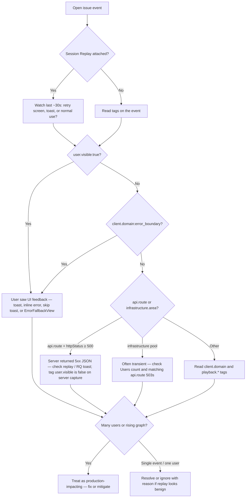

| `SENTRY_RELEASE`                        | Optional; defaults to **`NEXT_PUBLIC_APP_BUILD_VERSION`** / **`VERCEL_GIT_COMMIT_SHA`**                                                                                                                                 |

**Saved issue searches (bookmark in Sentry):**

| View                  | Query                                                                                                                                                                                                                    |
| --------------------- | ------------------------------------------------------------------------------------------------------------------------------------------------------------------------------------------------------------------------ |
| Production backlog    | [`is:unresolved environment:production`](https://filtermydiscogs.sentry.io/issues/?project=javascript-nextjs&query=is%3Aunresolved+environment%3Aproduction)                                                             |
| User-visible (tagged) | [`is:unresolved environment:production user.visible:true`](https://filtermydiscogs.sentry.io/issues/?project=javascript-nextjs&query=is%3Aunresolved+environment%3Aproduction+user.visible%3Atrue)                       |
| User-visible crashes  | [`is:unresolved environment:production client.domain:error_boundary`](https://filtermydiscogs.sentry.io/issues/?project=javascript-nextjs&query=is%3Aunresolved+environment%3Aproduction+client.domain%3Aerror_boundary) |
| API **5xx**           | [`is:unresolved environment:production tags[api.route]:*`](https://filtermydiscogs.sentry.io/issues/?project=javascript-nextjs&query=is%3Aunresolved+environment%3Aproduction+tags%5Bapi.route%5D%3A*)                   |
| Playback embed skips  | [`tags[playback.skip_source]:*`](https://filtermydiscogs.sentry.io/issues/?project=javascript-nextjs&query=tags%5Bplayback.skip_source%5D%3A*)                                                                           |
| Bug reports           | [`issue.category:feedback`](https://filtermydiscogs.sentry.io/issues/?project=javascript-nextjs&query=issue.category%3Afeedback)                                                                                         |

**Is this fatal? (decision tree)**

Start on a **production** issue (`environment:production`). Local/preview events are for debugging only unless you are reproducing.

**Tag cheat sheet (set in code):**

| Tag                                             | Meaning                                                                                                                                                                                         |
| ----------------------------------------------- | ----------------------------------------------------------------------------------------------------------------------------------------------------------------------------------------------- |
| **`user.visible:true`**                         | Toast, inline panel error, playback skip toast, mosaic error state, or **`ErrorFallbackView`** (retry screen).                                                                                  |
| **`user.visible:false`**                        | Server **`createErrorResponse`** / **`reportApiRouteFailure`** captures, infra (**`reportInfrastructureFailure`**), dashboard collection-value segment (API already reported or silent widget). |
| **`httpStatus`** (tag + **`extra.httpStatus`**) | Sanitized status from **`createErrorResponse`** / **`logSanitizedApiRouteFailure`** on **5xx** only.                                                                                            |
| **`client.domain`**                             | Client product surface (`error_boundary`, `donation`, …).                                                                                                                                       |
| **`api.route`**                                 | App Router handler path (e.g. **`/api/crates/[id]`**).                                                                                                                                          |

**Frequency last:** one event on localhost/preview ≠ production fire. **`user.visible:true`** + multiple users in **`environment:production`** = highest priority.

**Close issues from GitHub:** In the PR description or squash commit message, include **`Fixes JAVASCRIPT-NEXTJS-<letter>`** (short id from the issue URL). Requires the [GitHub integration](https://docs.sentry.io/product/integrations/source-code-mgmt/github/) with “resolve in Sentry when a PR is merged” enabled.

